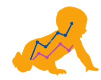

```{r}
#| echo: false
#| message: false
# This code is the last one run on the cluster project. I compare several clustering methods to see how consistent they are/how robust the results aree and which one is the most relevant to create groups of people based on their intention to enroll in early childcare facilities.

# The LCA is done with a smaller number of predictors, and should be fine grained.
library(pacman)
p_load(here, 
       tidyverse, # for data processing 
       cluster, # functions for clustering 
       NbClust, # to calculate indices and draw plot
       hopkins, 
       factoextra,  # for visualization
       mclust,
       fpc, # for plotclust
       clustMixType , 
       bestNormalize,
       factoextra, 
       fclust, 
       poLCA, 
       tidymodels
)
# 


select <- dplyr::select
summarize <- dplyr::summarize


set.seed(666)


```

```{r LoadData, include=FALSE}
#| echo: false
#| message: false

source(here("RScripts","LoadAllData.R"), local = knitr::knit_global())

```

```{r}
#| echo: false
#| message: false
dataset <- MainDB %>%
  select(
Intention,  # Dependent variable
# Baseline characteristics
Active,     # Active mother
NumberChildren,
BirthPlace3,
AccessInformalFullTime,
Age,
Educ3,
Educ3Dad,
SingleMum,
     CoupleCohabiting,
     ComputerYN ,
     HighLowECECBaseline ,
                 Language3,
                 SmokePreg,
                 BreastFeedIntend,
                 BreastFeedLength,
                 FmlyIncomeBaseline,
                 IncomeBaseline,
                 ECSIdealAgeEntryBaseline,
                 AffordSubsidiesBaseline,
                 AffordNMCostWBBaseline,
                 AffordOppCostBaseline,                                                                   # 
                 AffordNMCostCareerBaseline,
                 DiscountRate,
                 AccessEasyBaseline,
                 AccessHoursBaseline,
                 NormsBaseline,
                 NormsOpposedN,
                LikertAccessInfoBaseline, # strongly disagree, disagree, don't know, agree, strongly agree
                LikertReturnHKBaseline,
                LikertAccessSoc, # strongly disagree, disagree, don't know, agree, strongly agree
                TrustAssMat,
                TrustCreche,
TrustFam, 
TrustFriend,
                DeprivClothes, # DEPRIVATION: do parents struggle to buy clothes?
                DeprivFood, # DEPRIVATION: do parents struggle to buy food?
                DeprivBills, # DEPRIVATION: do parents struggle to pay for the bills?
                DeprivHolidays, # DEPRIVATION: do parents struggle to go in holidays?
                DeprivHousing, # DEPRIVATION: do parents struggle to pay for housing?
                InformalReciprocity, # Do the parents already take care of the children of others
                AffordCostDK, 
                AffordCostBaseline, 
                Primipare ,
                Age ,
                AccessEasy5, 
                KnowsCreche,
                KnowsAssMat, 
Educ, ECSUseYes, ECSApp

) %>%
  mutate(
    NormsOpposedN = as.numeric(NormsOpposedN), 
  #  KnowsCreche = as.factor(KnowsCreche),
  #  KnowsAssMat = as.factor(KnowsAssMat), 
    IdealEntryAge = as.factor(ifelse(ECSIdealAgeEntryBaseline == "Jamais", "Pendant ses trois premiers mois", as.character(ECSIdealAgeEntryBaseline))), # it causes prb and I am worried it is collinear with the DV. Most ppl that said no also reponded "jusqu'à la maternelle"
    BirthPlace3 = as.factor(ifelse(BirthPlace3 == "Je ne souhaite pas répondre", "Else", as.character(BirthPlace3)))
         ) %>%
  mutate(across(where(is.logical), as.factor)) %>% 
  mutate(across(where(is.character), as.factor))
# Add knowledge variables


# Removed because of NAs: Breastfeed variables (not mendatory and not that relevant), Trust Family and Friends (maybe not that much relevant anyway either)
# Educ3
# recode discount in "Present bias"
# One possibility is to remove Income, that may have not random NAs and we have education anyways

# One other possibility is to remove the perceived costs, because it would take a loooot of observations aways
# Cleaning the data
work_df <- dataset %>%
  mutate(Intention = factor(Intention, labels = c("No", "Yes"))) %>% 
  select(c(Intention, 
           NormsOpposedN,
         #  AffordCostBaseline, 
           Educ3, 
           DiscountRate,# to recode 
     ComputerYN,
             AffordSubsidiesBaseline, # Whether the person knows that chidlcare is subsidized
             AffordNMCostWBBaseline,
             AffordOppCostBaseline,
             AffordNMCostCareerBaseline,
             DiscountRate,
             AccessHoursBaseline, 
     Primipare, 
     BirthPlace3, 
     Active,  
AccessInformalFullTime,
Age,
SingleMum, 
#FmlyIncomeBaseline,
                #IncomeBaseline,
                LikertReturnHKBaseline,
                TrustCreche,
TrustAssMat,
                KnowsCreche,
                KnowsAssMat, 
     ComputerYN ,
     HighLowECECBaseline ,
Language3,
             #   AffordCostDK, 
              #  AffordCostBaseline,
#                 AccessEasyBaseline,    you have to remove it because you have it twice
                 NormsBaseline,
                LikertAccessInfoBaseline, # strongly disagree, disagree, don't know, agree, strongly agree
                LikertAccessSoc, # strongly disagree, disagree, don't know, agree, strongly agree
       #          DeprivClothes, # DEPRIVATION: do parents struggle to buy clothes?
       #         DeprivFood, # DEPRIVATION: do parents struggle to buy food?
       #         DeprivBills, # DEPRIVATION: do parents struggle to pay for the bills?
       #         DeprivHolidays, # DEPRIVATION: do parents struggle to go in holidays?
       #         DeprivHousing,# DEPRIVATION: do parents struggle to pay for housing?              
#NumberChildren,
              #  TrustFam,
              #  TrustFriend,
    # CoupleCohabiting,
AccessEasy5, 
Educ, ECSUseYes, ECSApp
)) %>% mutate(
    Educ3 = factor(Educ3, levels = c("Bac or Less", "Undergrad", "Graduate"), ordered = TRUE), 
    PresentOrientation = factor(ifelse(DiscountRate == "50€ dans 3 jours", "PresentOriented", "NotPresentOriented"), ordered = FALSE),
    AffordNMCostWBBaseline = factor(AffordNMCostWBBaseline, levels = c("Positif", "Pas d'impact", "Je ne sais pas encore", "Négatif"), ordered = TRUE),
    AffordOppCostBaseline = factor(AffordOppCostBaseline, levels = c("Positif", "Pas d'impact", "Je ne sais pas encore", "Négatif"), ordered = TRUE),
    AffordNMCostCareerBaseline = factor(AffordNMCostCareerBaseline, levels = c("Positif", "Pas d'impact", "Je ne sais pas encore", "Négatif"), ordered = TRUE),
    AccessHoursBaseline = factor(AccessHoursBaseline, levels = c("Non", "Je ne sais pas encore", "Non, mais on prendra un autre mode de garde en plus", "Oui"), ordered = TRUE),
    TrustAssMat = factor(TrustAssMat, levels = c("Très en désaccord", "Assez en désaccord", "Je ne sais pas", "Assez d’accord","Très d’accord"), ordered = TRUE),
    NormsBaseline = factor(NormsBaseline, levels = c("Aucune", "Une minorité", "Moitié moitié", "Ne sait pas", "La plupart", "Toutes"), ordered = TRUE),
    LikertAccessSoc = factor(LikertAccessSoc, levels = c("Très en désaccord", "Assez en désaccord", "Je ne sais pas", "Assez d’accord", "Très d’accord"), ordered = TRUE),
    LikertAccessInfoBaseline = factor(LikertAccessInfoBaseline, levels = c("Très en désaccord", "Assez en désaccord", "Je ne sais pas", "Assez d’accord", "Très d’accord" ), ordered = TRUE),
    AccessEasy5 = factor(AccessEasy5, levels = c("Easy", "DontKnow", "Hard", "Impossible"), ordered = TRUE)
    # Not sure about this one
  ) %>% select(-DiscountRate) # we recoded it, we don't want to keep both 


```

# Motivations

## The broad picture

::: columns
::: {.column width="50%"}
-   Evidence that attending **high-quality early childcare** (e.g., daycare) is an effective lever to reduce inequalities during early childhood [@bergerImpactCenterBasedChildcare2020; @VanHuizen2013; @Schmutz2024]: employment & child development.

-   However, in most OECD countries there is an **early childcare enrollment gap** between households from low and high socioeconomic backgrounds [@OECD2016].
:::

::: {.column width="50%"}
{width="100%"}
:::
:::

## Understanding the SES-gap in early childcare enrollment

-   ***Supply-side factors***: **affordability, quality, and accessibility** of childcare services.

-   ***Demand-side factors***:

    1.  Several factors could lead households to be **less willing to enroll** in these facilities.
    2.  Several factors could prevent households to **apply** in these facilities.

## Research question

Who are the households who are willing to enroll and who are the ones who are not?

-   `r nrow(work_df)` questionnaires with households expecting a child in Paris region.

-   **Intention** to enroll in early childcare facilities: binary variable with 80% of households willing to enroll.

```{r}
#| echo: false
#| message: false
table(work_df$Intention)

```

## Description of the variables

::: columns
::: {.column width="50%"}
***Beliefs and norms***

-   $Norms$: 2 variables 1) Share of people who actually enroll(ed) their child in early childcare, 2) Share of people who the participant think are opposed to the idea of enrolling their child in a childcare facility .

-   $Impact$: Perceived impact of staying at home on 1) household income and on the mother's 2) well-being, and 3) career.

-   $Trust$: Trust in the each childcare facilities.

-   Perceived $difficulty$ to access early childcare.

-   Beliefs about the $benefits$ of early childcare for children development
:::

::: {.column width="50%"}
**Knowledge**

-   $Subsidies$: whether participants know that early childcare is heavily subsidized in France.

-   $Types$ of early childcare known.

**Resources**

-   Access to $informal$ *care*.

-   Access to $information$.

-   Access to $social$ *resources* to help with paperwork.

-   Access to $computer$.
:::
:::

No SES variables were included in the clustering, but used later as covariates (`Education`, `BirthPlace`).

# Workflow

1.  **Hierarchical** **clustering** using `agnes` and `complete` linkage
2.  **Non**-**Hierarchical** clustering using `PAM`
3.  **Fuzzy** clustering using `fanny`
4.  **Latent Class Analysis**

```{r}
#| echo: false
#| message: false

# Load the DiagrammeR package
p_load(DiagrammeR)
# Create the flowchart
grViz("
digraph flowchart {
  
  # Node definitions with HTML-like labels
  node [fontname = Helvetica, shape = box, style = filled, color = lightblue]
  
  A [label = <<TABLE BORDER=\"0\" CELLBORDER=\"0\" CELLSPACING=\"0\">
              <TR><TD><B><FONT POINT-SIZE=\"16\">Hierarchical </FONT></B></TD></TR>
              <TR><TD><FONT POINT-SIZE=\"12\">agnes</FONT></TD></TR>
             </TABLE>>]
  
  B [label = <<TABLE BORDER=\"0\" CELLBORDER=\"0\" CELLSPACING=\"0\">
              <TR><TD><B><FONT POINT-SIZE=\"16\">Non-Hierarchical </FONT></B></TD></TR>
              <TR><TD><FONT POINT-SIZE=\"12\">PAM</FONT></TD></TR>
             </TABLE>>]
  
  C [label = <<TABLE BORDER=\"0\" CELLBORDER=\"0\" CELLSPACING=\"0\">
              <TR><TD><B><FONT POINT-SIZE=\"16\"> Fuzzy Clustering </FONT></B></TD></TR>
              <TR><TD><FONT POINT-SIZE=\"12\"> Fanny </FONT></TD></TR>
             </TABLE>>]
             
 D [label = <<TABLE BORDER=\"0\" CELLBORDER=\"0\" CELLSPACING=\"0\">
              <TR><TD><B><FONT POINT-SIZE=\"16\"> Latent Class Analysis </FONT></B></TD></TR>
              <TR><TD><FONT POINT-SIZE=\"12\">  </FONT></TD></TR>
             </TABLE>>]

  # Edge definitions
  A -> B -> C -> D
}
")

```

-   Distance: `gower` because mixed data


## Latent Classes description {visibility="hidden"}

```{r}
#| echo: false
#| message: false

work_df_cluster <- work_df %>% 
  drop_na() %>% select(-c(Educ3, BirthPlace3, Language3, Educ, Age, Primipare, TrustAssMat, Active, SingleMum, HighLowECECBaseline ))

D <- daisy(work_df_cluster, metric = "gower", stand = TRUE)
sil <- NbClust(diss = D, # calculated distance matrix with "gower" distances
               distance = NULL, # NULL because we provide D
               method = "mcquitty", # linkage method (closest to PAM)
               min.nc = 2, # minimum number of clusters
               max.nc = 10, # maximum number of clusters
               index = "silhouette" ) 

sil$All.index # all silhouette indices for all k's
# 2 medoids seem optimal, but I will choose 3 because the silhouette indexes are really close and it keeps consistency with the other methods


# Run PAM with 3 clusters for the non hierarchical clustering method
kmed <- pam(D, 
            k = 3, 
            diss = TRUE # dissimilarity matrix 
            )


```

# Results

::: columns
::: {.column width="33%"}
**Hierarchical and Non-Hierarchical clustering**

```{r}
#| echo: false
#| message: false
set.seed(345)

# We apply agnes to the dissimilarity matrix with Gower
res.agnes <- agnes(D, diss = TRUE, method = "complete") # Diss = TRUE, indicates that we use a distance matrix 

# Generate the dendrogram
plot(res.agnes,hang = -0.1, which.plots = 2, main = "") # plot the dendrogram
# based on distance (branch length) the 3 clusters solution seems to be the best


```
:::

::: {.column width="33%"}
**Fuzzy clustering**

-   3 clusters solutions

```{r}
#| echo: false
#| message: false

set.seed(678)
# Perform fuzzy clustering with k = 3 using fanny for the fuzzy clustering
# We keep 3 for consistance because fviz_nbclust does not work......
# you could also try NEFRC to compare
res.fanny <- fanny(x = D, # distance matrix
                   k = 3, # number of clusters
                   diss = TRUE, 
                   memb.exp = 1.3) # use dissimilarity matrix


```
:::

::: {.column width="33%"}
**LCA**

-   The 3 clusters solution has the lowest BIC
:::
:::

# Comparing solutions

## Non-Hierarchical clustering (PAM)

```{r}
#| echo: false
#| message: false

# Calculate the average values of the variables for each cluster done with PAM (NHC)
res <- aggregate(x = .~ kmed$clustering, # cluster variable
          data = work_df_cluster, 
          FUN = mean )
#### BUILD THE PLOTS
# We will use only the variables that are the most illustrative for the plots

res <- res %>% as.data.frame() %>% arrange(desc(Intention)) %>% mutate(Cluster = c(1,2,3)) %>%  select(Cluster, Intention, NormsOpposedN,NormsBaseline , AffordSubsidiesBaseline, AffordNMCostWBBaseline, AffordOppCostBaseline, AffordNMCostCareerBaseline, AccessHoursBaseline, AccessInformalFullTime, LikertReturnHKBaseline, TrustCreche) %>% mutate(
  NOpposed= NormsOpposedN,
  ShareUse = NormsBaseline , 
  KnowsSubsidies = AffordSubsidiesBaseline, 
  WellBeing = AffordNMCostWBBaseline, 
  OppCost = AffordOppCostBaseline, 
  Career = AffordNMCostCareerBaseline, 
  ECHours= AccessHoursBaseline, 
  InformalCare = AccessInformalFullTime, 
  Benefits = LikertReturnHKBaseline, 
  Trust = TrustCreche, 
  Cluster = as.factor(Cluster)
  
) %>% select(Cluster, Intention, NOpposed, 
             ShareUse, 
             KnowsSubsidies, 
             WellBeing, 
             OppCost,
             Career, 
             ECHours, 
             InformalCare, 
             Benefits, 
             Trust)

# Transformation en format long
data_long <- pivot_longer(res, cols = -Cluster, names_to = "Variable", values_to = "Mean")

# Réordonner les niveaux pour que "Intention" soit la première variable
data_long$Variable <- factor(data_long$Variable, levels = c("Intention", unique(data_long$Variable[data_long$Variable != "Intention"])))


# Création du graphique avec facet grid
ggplot(data_long, aes(x = Cluster, y = Mean, fill = Cluster)) +
  geom_bar(stat = "identity", position = "dodge") +
  facet_wrap(~ Variable, scales = "free_y", ncol = 4) +
  labs(title = "Mean Values for Each Variable Across Clusters",
       x = "Cluster",
       y = "Mean Value") +
  theme_minimal() 
```

## Fuzzy clustering

```{r}
#| echo: false
#| message: false

# Fuzzy clustering
# Calculate the average values of the variables for each cluster
res2 <- aggregate(x = .~res.fanny$clustering, 
          data = work_df_cluster, # data set
          FUN = mean) # function to apply
## We can interpret them as percentages because the variables are binary

res2 <- res2 %>% as.data.frame() %>% arrange(desc(Intention)) %>% mutate(Cluster = c(1,2,3)) %>%  select(Cluster, Intention, NormsOpposedN,NormsBaseline , AffordSubsidiesBaseline, AffordNMCostWBBaseline, AffordOppCostBaseline, AffordNMCostCareerBaseline, AccessHoursBaseline, AccessInformalFullTime, LikertReturnHKBaseline, TrustCreche) %>% mutate(
  NOpposed= NormsOpposedN,
  ShareUse = NormsBaseline , 
  KnowsSubsidies = AffordSubsidiesBaseline, 
  WellBeing = AffordNMCostWBBaseline, 
  OppCost = AffordOppCostBaseline, 
  Career = AffordNMCostCareerBaseline, 
  ECHours= AccessHoursBaseline, 
  InformalCare = AccessInformalFullTime, 
  Benefits = LikertReturnHKBaseline, 
  Trust = TrustCreche, 
  Cluster = as.factor(Cluster)
) %>% select(Cluster, Intention, NOpposed, 
             ShareUse, 
             KnowsSubsidies, 
             WellBeing, 
             OppCost,
             Career, 
             ECHours, 
             InformalCare, 
             Benefits, 
             Trust)


# Transformation en format long
data_long <- pivot_longer(res2, cols = -Cluster, names_to = "Variable", values_to = "Mean")

# Réordonner les niveaux pour que "Intention" soit la première variable
data_long$Variable <- factor(data_long$Variable, levels = c("Intention", unique(data_long$Variable[data_long$Variable != "Intention"])))


# Création du graphique avec facet grid
ggplot(data_long, aes(x = Cluster, y = Mean, fill = Cluster)) +
  geom_bar(stat = "identity", position = "dodge") +
  facet_wrap(~ Variable, scales = "free_y", ncol = 4) +
  labs(title = "Mean Values for Each Variable Across Clusters",
       x = "Cluster",
       y = "Mean Value") +
  theme_minimal() 
```

# Latent Class Analysis

## Latent Class {visibility="hidden"}

```{r, echo= FALSE, message=FALSE}
#| echo: false
#| message: false

# select a few number of variables first
# more variables should be added iteratively in the future

work_df_cluster_LCA_small <- work_df %>% 
  drop_na() %>% mutate(NormsOpposedN =case_when( # LCA does not allow for continuous variables so we break it
    NormsOpposedN == 0 ~ "0",
    NormsOpposedN == 1 ~ "1",
  ( NormsOpposedN == 2 |  NormsOpposedN == 3) ~ "2/3",
    NormsOpposedN == 4 ~ "4/5",
    NormsOpposedN >= 5 ~ "more than 5"), 
    NormsOpposedN = factor(NormsOpposedN, ordered = TRUE), 
  KnowsCreche = KnowsCreche+1, # it doesn't like 01s either so we turn it into 1 2 
  KnowsAssMat = KnowsAssMat+1, 
  HigerEducOrLess = ifelse(Educ3 == "Bac or Less", 1, 0), # we create dummies for the LCA (predictors)
  Graduate = ifelse(Educ3 == "Graduate", 1, 0),
  Undergrad = ifelse(Educ3 == "Undergrad", 1, 0), 
  France = ifelse(BirthPlace3 == "France", 1, 0 ), 
  SubsAfrica =  ifelse(BirthPlace3 == "Else", 1, 0 ), 
  MENA =ifelse(BirthPlace3 == "MENAsie", 1, 0 ) ) %>% 
  select(Intention,  NormsBaseline, TrustCreche,  AccessInformalFullTime, NormsOpposedN, PresentOrientation, KnowsAssMat, Graduate, Undergrad, LikertReturnHKBaseline,SubsAfrica, France, MENA, ECSUseYes, ECSApp, HigerEducOrLess ) 

set.seed(1234)
# see cluster.qmd for BIC choice == it leads to 3 clusters

# Perform LCA with 3 classes

# Prepare the model. In this one, we include education dummies and place of birth dummies as covariates
f <- cbind(Intention, NormsBaseline, TrustCreche,  AccessInformalFullTime, # NormsOpposedN
           PresentOrientation, KnowsAssMat, LikertReturnHKBaseline)~ Undergrad + Graduate + France + MENA  # covariates after the ~
# Perform the LCA
ch3 <- poLCA(f,work_df_cluster_LCA_small,nclass=3, maxiter = 5000)
# we see the same pattern emerging: one has 76% proba not the want to use EC and the other higher probabilities to use EC

# Reorder the probabilities to have a more meaningful interpretation ===> NO NEED with nrep = 50
probsstart_new <- poLCA.reorder(ch3$probs.start,
                             c(1,3, 2))
ch3 <- poLCA(f,work_df_cluster_LCA_small,nclass=3, maxiter = 5000, nrep = 50, probs.start = probsstart_new)
#
# BIC(3): 14335.46

```

## Latent Classes description {visibility="hidden"}

```{r, echo= FALSE, message=FALSE}
#| echo: false
#| message: false


```

## Plot Latent Classes

```{r, echo= FALSE, message=FALSE}
#| echo: false
#| message: false
plot(ch3)
```

## Latent Classes description

```{r, echo= FALSE, message=FALSE}
#| echo: false
#| message: false

# If you look at the begining  "Categories for manifest items :" tells you which one is what
ch3 

```

# With grouping on the level of eduation 

## {visibility="hidden"}

```{r}
#| echo: false
#| message: false
p_load(glca)

# This time we want to do grouping on education that is similar to doing split regressions instead of just an interaction
work_df_cluster_LCA_small_group <- work_df %>% 
  drop_na() %>% mutate(NormsOpposedN =case_when(
    NormsOpposedN == 0 ~ "0",
    NormsOpposedN == 1 ~ "1",
  ( NormsOpposedN == 2 |  NormsOpposedN == 3) ~ "2/3",
    NormsOpposedN == 4 ~ "4/5",
    NormsOpposedN >= 5 ~ "more than 5"), 
    NormsOpposedN = factor(NormsOpposedN, ordered = TRUE), 
  KnowsCreche = KnowsCreche+1, 
  KnowsAssMat = KnowsAssMat+1) %>% 
  select(Intention,  NormsBaseline, TrustCreche,  AccessInformalFullTime, NormsOpposedN, PresentOrientation, KnowsAssMat, Educ3, LikertReturnHKBaseline, ECSUseYes, ECSApp)


mod <- glca(item(Intention, NormsBaseline, TrustCreche,  AccessInformalFullTime, # NormsOpposedN
           PresentOrientation, KnowsAssMat, LikertReturnHKBaseline)~1, group = Educ3, data = work_df_cluster_LCA_small_group, nclass = 3, maxiter = 5000) 


```

## Results

```{r}
#| echo: false
#| message: false

summary(mod)
# We find again the same pattern (the order is reversed again: class 2 is 3 and 3 is 2). There is a low likelyhood to be in class 1 overall, which make sense because a lot of people want to use EC.
# But being low educated is assotiated with a higher probability to be in classs 1 
# the graduate have the higher proba to be in the class that is most likely to want EC

```

## Additional explorations

```{r}
#| echo: false
#| message: false

## In this chunk we will try to see whether the clusters are associated with proba of applying one year later

library(fixest)
work_df_cluster_LCA_small$Clusters <- ch3$predclass # we add the clusters to the dataset

work_df_cluster_LCA_small <- work_df_cluster_LCA_small %>% mutate(Clusters = as.factor(Clusters)) # we make it a factor

```


```{r}
#| echo: false
#| message: false
p_load(fixest, 
       modelsummary, 
       flextable)
## Generate a table to see how much being in cluster 1, 2 or 3 is associated with the probability to apply to and use early childcare one year later, compared to a naive model that use intention during pregancy to predict application and use

mod        <- feols(ECSApp ~ Clusters, data = work_df_cluster_LCA_small) # application

mod2        <- feols(ECSUseYes ~ Clusters, data = work_df_cluster_LCA_small) # use

md3 <- feols(ECSApp ~ Undergrad + HigerEducOrLess, data = work_df_cluster_LCA_small)
md3 <- feols(ECSApp ~ i(Intention, ref= "Yes"), data = work_df_cluster_LCA_small) # naive model with intention


modelsummary(list( "P(Apply to early childcare): Naïve"                      = md3,
"P(Apply to early childcare)"                      = mod,                
"P(Use early childcare)"                     = mod2
), statistic = "{std.error} ({p.value})",
                      estimate="{estimate}{stars}  [{conf.low}, {conf.high}]",
                      gof_map = c("r.squared" ,"adj.r.squared" ,"nobs", "vcov.type", "FE"="FE: WardxWave" ),
                      stars = c("***"=.01,"**"=.05,"*"=.1),
                      title="Probability to apply and use early childcare one year later",
                      notes=list("",
                                 "Coefficient, 95 % CI in brackets, standard errors, p-value or adjusted p-value in parenthesis")
                      ,output = 'flextable',escape=TRUE) |> autofit()


```


##


```{r}
#| echo: false
#| message: false
p_load(fixest, 
       modelsummary, 
       flextable)

# Do the same but the naive model is here the level of education 
md3 <- feols(ECSApp ~ Undergrad + HigerEducOrLess, data = work_df_cluster_LCA_small)


modelsummary(list( "P(Apply to early childcare): Naïve"                      = md3,
"P(Apply to early childcare)"                      = mod,                
"P(Use early childcare)"                     = mod2
), statistic = "{std.error} ({p.value})",
                      estimate="{estimate}{stars}  [{conf.low}, {conf.high}]",
                      gof_map = c("r.squared" ,"adj.r.squared" ,"nobs", "vcov.type", "FE"="FE: WardxWave" ),
                      stars = c("***"=.01,"**"=.05,"*"=.1),
                      title="Probability to apply and use early childcare one year later",
                      notes=list("",
                                 "Coefficient, 95 % CI in brackets, standard errors, p-value or adjusted p-value in parenthesis")
                      ,output = 'flextable',escape=TRUE) |> autofit()


```
# Discussion

-   "I don't know" were merged with "No" in the intention variable. Should they be distinguished?
-   Use dimension reduction techniques or score for some groups of predictors (e.g. knowledge).
- Try LCA with a bigger number of variables to see whether the findings hold.
- (If running regressions like this really makes sense) Re run the analyses to predict one year later on the control group only.


## References

::: {#refs}
:::
